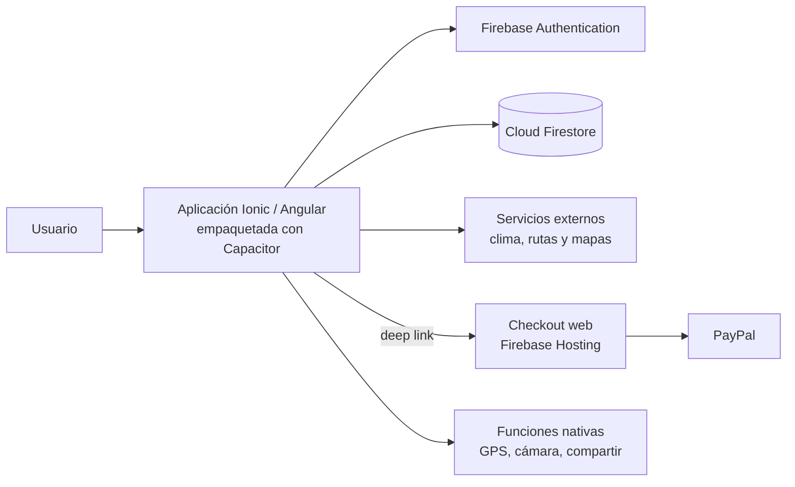

# Documentacion_ProyectoAPT_Code-Trekking

## Nombre del proyecto:

Code-Trekking - Aplicación móvil de trekking colaborativo y seguro.

## Descripción: qué hace, a quién va dirigido, qué problema resuelve

### Que hace:

Code-Trekking es una aplicación móvil desarrollada para personas interesadas en realizar actividades de trekking en la Región Metropolitana de Chile.

El proyecto busca facilitar la organización de actividades grupales de trekking mediante una plataforma que permita a los usuarios encontrar compañeros, crear y participar en eventos, consultar información sobre rutas y comunicarse con otros participantes.

Además, la aplicación incorpora funcionalidades orientadas a la seguridad, como seguimiento de ubicación mediante GPS, registro del recorrido y un botón SOS que permite compartir la ubicación del usuario con sus contactos de emergencia.

Funcionalidades adicionales: exportación del recorrido a GPX, foro por evento, clima en tiempo real, contenido educativo (trekking, supervivencia y primeros auxilios), galería de fotos con suscripción y pagos con PayPal, términos y condiciones versionados y panel de administración.

### A quién va dirigido:

La aplicación está dirigida principalmente a:

- Personas adultas interesadas en realizar trekking.
- Personas que están comenzando a practicar trekking.
- Personas con experiencia que buscan nuevas rutas.
- Personas que no cuentan con un grupo para realizar actividades.
- Organizadores de actividades de trekking.
- Inicialmente, el proyecto se encuentra orientado a usuarios de la Región Metropolitana de Chile.

### Qué problema resuelve:

Las personas interesadas en realizar trekking pueden presentar dificultades para:

- Encontrar personas que compartan el mismo interés y disponibilidad.
- Organizar actividades grupales de manera sencilla.
- Acceder a información centralizada sobre las rutas.
- Conocer características técnicas de una ruta antes de realizarla.
- Mantener comunicación con los participantes de una actividad.
- Contar con herramientas de ubicación y comunicación ante una emergencia.

Actualmente, estas necesidades suelen resolverse utilizando diferentes plataformas y aplicaciones de manera independiente.

Code-Trekking busca centralizar estas funcionalidades en una sola aplicación móvil, proporcionando una experiencia colaborativa y orientada a la seguridad.

## Tecnologías utilizadas (lenguajes, frameworks, base de datos, cloud):

- Angular — Framework principal para el desarrollo de la aplicación.
- Ionic Framework — Componentes de interfaz y desarrollo de la aplicación móvil.
- TypeScript — Lenguaje principal del proyecto.
- HTML5 — Estructura de las interfaces.
- SCSS / CSS — Estilos y diseño visual.
- Firebase Authentication — Autenticación y gestión de usuarios.
- Cloud Firestore — Base de datos NoSQL en la nube.
- Firebase Security Rules — Control de acceso y seguridad de los datos. Las reglas se administran desde la consola de Firebase y no están versionadas en este repositorio.
- Capacitor — Empaquetado como aplicación nativa de Android y acceso a GPS, cámara, compartir y archivos.
- Firebase Hosting — Aloja la página de pago (checkout-web) usada por PayPal.
- PayPal — Pagos y suscripciones.
- Leaflet — Mapas y trazado de rutas.
- GitHub Actions — Integración continua y generación de la APK de Android.
- Jasmine y Karma — Pruebas unitarias.

### *** Variables de Entorno ***

El proyecto centraliza sus credenciales y claves de servicios externos en un archivo .env, excluido del repositorio mediante .gitignore. Al ejecutar npm run config (invocado automáticamente por los scripts start, build y watch), el script scripts/set-env.ts genera src/environments/environment.ts y environment.prod.ts a partir de esas variables. En GitHub Actions, el mismo contenido se entrega mediante el secreto del repositorio ENV_FILE.

| Variable | Descripción |
|---|---|
| FIREBASE_API_KEY | API Key del proyecto Firebase. |
| FIREBASE_AUTH_DOMAIN | Dominio de autenticación de Firebase Authentication. |
| FIREBASE_PROJECT_ID | Identificador del proyecto de Firebase. |
| FIREBASE_STORAGE_BUCKET | Bucket de Firebase Storage. Forma parte de la configuración estándar de Firebase; actualmente no se utiliza, ya que las fotos se guardan en Firestore. |
| FIREBASE_MESSAGING_SENDER_ID | Identificador del remitente de Firebase Cloud Messaging. |
| FIREBASE_APP_ID | Identificador de la app dentro del proyecto Firebase. |
| WEATHER_API_KEY | Clave del servicio meteorológico externo (información climática). |
| ORS_KEY | Clave de OpenRouteService, usada para el trazado de rutas en el mapa. |
| THUNDERFOREST_KEY | Clave de Thunderforest, usada para las capas de mapa (terreno/topográfico). |
| PAYPAL_CLIENT_ID | Client ID de la cuenta de comercio de PayPal, usado por el SDK de pagos. |
| PAYPAL_CURRENCY | Moneda del cobro en PayPal (por defecto USD). |
| PAYPAL_CHECKOUT_URL | URL del checkout-web publicado en Firebase Hosting, usado en el pago nativo. |
| APP_URL_SCHEME | Esquema de deep link de la app (por defecto codetrekking), usado para el retorno desde PayPal en Android/iOS. |

## Instrucciones para ejecutar el proyecto localmente:

Antes de ejecutar el proyecto es necesario contar con:

- Node.js.
- npm instalado.
- Angular CLI e Ionic CLI instalados globalmente (npm i -g @angular/cli @ionic/cli).
- Un clon o copia del repositorio.
- GitHub.
- Ingresar a actions de Github, si se desea descargar la aplicación como APK del último commit del main.
- Las credenciales correspondientes a los servicios externos utilizados por la aplicación.
- Chrome, si se desean ejecutar las pruebas unitarias.

### Clonar e ingresar al repositorio

```bash
git clone https://github.com/DaniloGCh/code-trekking.git
cd code-trekking
```

### Instalar las dependencias

Ejecutar en la terminal:

```bash
npm i -g @angular/cli @ionic/cli
npm install
```

Si `npm install` muestra conflictos de dependencias, ejecutar `npm install --legacy-peer-deps` (es la opción que usa la integración continua).

### Configurar las variables de entorno (.env)

Dado que las credenciales no se suben al repositorio por seguridad, deberás crear manualmente el archivo de configuración:

1. Solicita al administrador o dueño del proyecto el contenido del archivo .env (se te enviará por mensaje privado).
2. En la raíz del proyecto (al mismo nivel que el archivo package.json), crea un nuevo archivo llamado exactamente .env.
3. Pega todo el contenido proporcionado en dicho archivo y guárdalo.

### Ejecutar la aplicación en el navegador

Para iniciar el servidor de desarrollo local:

1. Ejecutar en la terminal: `npm install dotenv`
2. Ejecutar en la terminal: `npm install @ionic/pwa-elements`
3. Luego ejecutar: `npm run build`
4. Y para finalizar: `ionic serve` (O en su defecto: `npm start` / `ng serve`)
5. Una vez finalizado el proceso de compilación, abre tu navegador e ingresa al proyecto.

### Ejecutar las pruebas unitarias (opcional)

Las pruebas unitarias no están en la rama `main`: se encuentran en la rama `pruebas_jasmine`, que no se une a `main`. Para ejecutarlas, primero hay que cambiarse a esa rama:

```bash
git fetch origin
git checkout pruebas_jasmine
npm install
npm test
```

Para ejecutarlas una sola vez y sin ventana: `npx ng test --watch=false --browsers=ChromeHeadless`

## Integrantes del equipo con sus roles

**Product Owner: Danilo González**
Define y prioriza el Product Backlog (funcionalidades del app), válida que cada incremento cumpla con la propuesta de valor de Code-Trekking, y es el punto de contacto principal con el docente/cliente simulado para retroalimentación.

**Scrum Master: Ismael Horta**
Facilita las ceremonias Scrum (planificación semanal, revisión y retrospectiva), da seguimiento a la bitácora y el repositorio Git, identifica y ayuda a resolver impedimentos técnicos, y vela por que el equipo respete la duración de los sprints semanales

**Equipo de Desarrollo: Ismael Horta / Danilo González:**
Ambos integrantes desarrollan en conjunto el frontend (Ionic/Angular), la integración con Firebase, los módulos de geolocalización/mapas y las funcionalidades de seguridad (SOS, sanitización, rate limiting), además de ejecutar las pruebas unitarias y el análisis estático de código.

Cabe recalcar que ambos integrantes participan en las actividades de análisis, diseño, desarrollo, pruebas, documentación y toma de decisiones del proyecto.

## Metodología de trabajo del equipo (Scrum, Kanban, DevOps, etc.)

El desarrollo de Code-Trekking utiliza la metodología ágil Scrum.

El proyecto se organiza en 18 sprints semanales, permitiendo dividir el desarrollo en incrementos funcionales y realizar revisiones periódicas del avance.

Fases del proyecto:

- Fase 1 — Definición (S1-S4): problema, objetivos, alcance, Product Backlog, requisitos no funcionales, diseño y plan de trabajo.
- Fase 2 — Desarrollo (S5-S15): implementación de las 78 historias de usuario y pruebas de cada sprint.
- Fase 3 — Cierre (S16-S18): pruebas en dispositivos reales, informe final y presentación.

## Arquitectura de la solución (descripción o diagrama)

Code-Trekking utiliza una arquitectura modular separando la presentación, lógica de negocio, acceso a datos y servicios externos.

La aplicación está desarrollada utilizando Angular como framework principal, Ionic para la interfaz móvil, Firebase para autenticación y persistencia de datos, y Capacitor para acceder a funcionalidades nativas del dispositivo.

Arquitectura general:

| Capa | Carpeta | Responsabilidad |
|---|---|---|
| Presentación | src/app/pages, src/app/components, src/app/tabs | Contiene las páginas de Ionic/Angular, los componentes reutilizables y la navegación por pestañas. Gestiona la interfaz y la interacción con el usuario. |
| Control de acceso | src/app/guards | Controla el acceso a las rutas según el estado de la sesión y los permisos del usuario. |
| Lógica de negocio | src/app/core/services | Coordina las funcionalidades de la aplicación, como la seguridad, el seguimiento de rutas y las alertas SOS. También gestiona la comunicación con Firebase y los servicios externos. |
| Interceptores HTTP | src/app/core/interceptors | Adjunta el token de sesión a las solicitudes HTTP dirigidas a servicios propios y redirige al inicio de sesión ante un error 401. Las solicitudes a servicios externos (clima, mapas y rutas) pasan sin modificar. |
| Modelos de datos | src/app/core/models | Define las interfaces y estructuras TypeScript utilizadas para organizar y representar los datos de la aplicación. |
| Capa de datos | Firebase Authentication, Cloud Firestore y localStorage | Gestiona la autenticación, el almacenamiento y la consulta de información en Firestore, además del almacenamiento local en el dispositivo o navegador. |
| Seguridad de datos | Firestore Security Rules | Define las reglas que controlan las operaciones de lectura y escritura permitidas sobre los datos almacenados en Firestore. |
| Servicios externos | APIs de OpenWeatherMap, OpenRouteService, OpenStreetMap, OpenTopoMap, Thunderforest, Wikiloc y OSRM | Proporciona funcionalidades de clima, mapas, visualización del terreno y cálculo de rutas. La comunicación utiliza HTTPS/TLS cuando los servicios lo admiten. |

Diagrama de la solución:



## Limitaciones conocidas

- No hay backend propio: el pago con PayPal se procesa en el cliente y no se valida el monto en un servidor.
- Las reglas de seguridad de Firestore se administran desde la consola de Firebase y no están versionadas en el repositorio.
